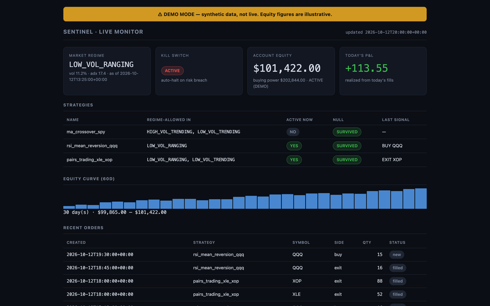
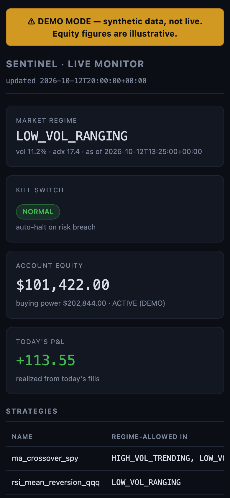
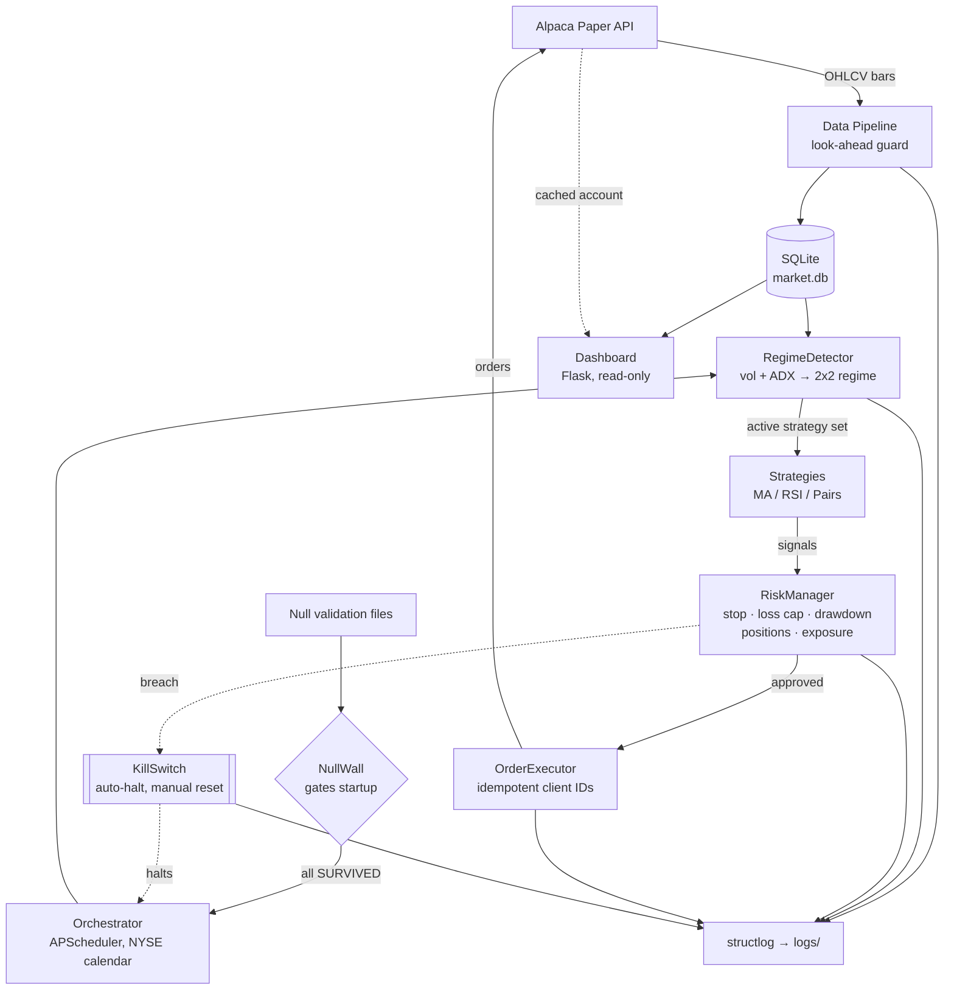

# Sentinel


-blue)


Sentinel is an agentic multi-strategy paper-trading system with regime-aware orchestration and a hard dependency on an external credibility gate ([Null](https://null-aksh.netlify.app)). No strategy trades in Sentinel until it has passed adversarial out-of-sample validation in Null. The two projects together form a build/attack pair: Null tests strategies, Sentinel runs the survivors.


<p align="center">
  
  
</p>

> *Screenshots above are rendered in **demo mode** with clearly-labeled synthetic data — see [Demo mode](#demo-mode).*

---

## Status

| | |
|---|---|
| **Tests** | 146 passing |
| **Mode** | Paper trading (Alpaca) |
| **Python** | 3.11+ |
| **License** | MIT |

> **Paper trading only.** Sentinel refuses to start against a live/funded Alpaca endpoint: the broker client hard-fails unless `ALPACA_BASE_URL` points at a paper host. There is no code path that places a real-money order.

---

## Architecture



The **Orchestrator** drives the loop on a trading-calendar-aware schedule; every trading *decision* is made by the pure-Python regime/strategy/risk layers. Any LLM/AI is confined to orchestration, monitoring, and reporting — never the decision path.

---

## The Null Wall

Sentinel's core discipline is *"I don't trust my own backtests."* A strategy that looks profitable in-sample is worthless until it survives adversarial, out-of-sample scrutiny. That scrutiny happens in a **separate project, [Null](https://null-aksh.netlify.app)** — an independent backtesting/validation tool that tries to break strategies.

The **Null Wall** encodes that distrust *in code, not in a comment*. At orchestrator startup, `NullWall.enforce` loads a signed validation record for every configured strategy and **refuses to start** if any record is:

- **missing** — the strategy was never run through Null;
- **not `SURVIVED`** — Null's verdict was `SHAKY` or `DEAD`;
- **stale** — the validation is more than 90 days old (strategies decay);
- **drifted** — the strategy's parameters changed since it was validated (the stored `params_hash` no longer matches the live config).

Validation records live at `validation/<strategy_name>.json`:

```json
{
  "strategy_name": "ma_crossover_spy",
  "null_url": "https://null-aksh.netlify.app",
  "validated_at": "2026-10-13",
  "verdict": "SURVIVED",
  "params_hash": "749ab7da5775...",
  "signed_by": "Aksh Patel",
  "notes": "Initial validation per Prompt 3; re-validate quarterly."
}
```

The committed records are a **mechanism, not pre-approval**: you regenerate a template with `python -m src.scripts.generate_validation_template <name>`, run the strategy through Null, and fill in the real verdict before go-live. Change a strategy's parameters and its old validation is automatically invalidated by the hash check.

---

## Non-negotiable design rules

These ten rules governed every line of the build and are enforced by code and tests, not convention:

1. **Paper trading only.** Live/funded keys are never accepted; the broker client hard-fails if the base URL is not a paper host.
2. **No look-ahead bias, no fabricated data.** The data pipeline guarantees `get_bars_as_of` can never return a bar after its cutoff; no synthetic market data is ever fed to a strategy (the one exception — dashboard demo mode — is advertising, not analysis, and is loudly labeled).
3. **Every decision is deterministic and logged** with a timestamp and a rationale.
4. **LLM/AI is walled off from the trading decision path** — used only for orchestration, monitoring, or reporting. Trade math is pure Python.
5. **Risk limits enforced at every level:** per-trade stop, per-day loss cap, max drawdown, max positions, max exposure.
6. **The kill switch triggers automatically on breach** — there is no manual override in code; reset is manual-only and must be acknowledged.
7. **Every strategy has both entry and exit logic.** No open-ended positions.
8. **No committing secrets.** Keys via `.env` only; `.env` is git-ignored.
9. **Tests pass before a task is complete.** If blocked, disclose — never fake.
10. **The Null wall:** no strategy trades in the bot until it passes Null validation, and the strategy interface is Null-compatible from day one.

---

## Technology stack

| Library | Why it's here |
|---|---|
| **Python 3.11** | Modern typing, `zoneinfo`, and dataclass ergonomics with no third-party backports. |
| **alpaca-py** | Official Alpaca SDK for the paper trading + market-data APIs. |
| **pandas** | OHLCV bar handling and the causal rolling-window math behind indicators. |
| **numpy** | Vectorized indicator / regime computations (realized vol, ADX, OLS hedge ratio). |
| **structlog** | Structured JSON logs (machine-parseable audit trail) plus readable console output. |
| **SQLAlchemy** | Typed ORM over SQLite for bars, signals, orders, fills, P&L, regime, and kill-switch events. |
| **APScheduler** | In-process cron scheduling for the pre-open / tick / pre-close jobs — no external broker. |
| **pandas_market_calendars** | NYSE trading calendar so jobs skip holidays and respect early-close days. |
| **statsmodels** | Engle-Granger cointegration test gating the pairs-trading strategy. |
| **Flask** | Tiny synchronous server for the read-only monitoring dashboard. |
| **pytest** | The whole test suite (146 tests, fully mocked — no network required). |

---

## Setup

```bash
# 1. Clone and create a virtual environment
git clone <your-fork-url> sentinel && cd sentinel
python3 -m venv .venv && source .venv/bin/activate
pip install -r requirements.txt

# 2. Configure paper credentials (NEVER live keys)
cp .env.example .env
#   then edit .env and paste your Alpaca PAPER key/secret.
#   ALPACA_BASE_URL must stay https://paper-api.alpaca.markets

# 3. Foundation smoke test (connects to paper, fetches + stores SPY bars)
.venv/bin/python -m src.hello_world

# 4. Seed more history for the strategies (SPY/QQQ/XLE/XOP are used by default)
.venv/bin/python -m src.scripts.dry_run_signals SPY     # read-only signal preview

# 5. Null validation: generate a template, run the strategy through Null, fill it in
.venv/bin/python -m src.scripts.generate_validation_template ma_crossover_spy
#   -> edit validation/ma_crossover_spy.json with the real Null verdict + sign it
#   (repeat for rsi_mean_reversion_qqq and pairs_trading_xle_xop)

# 6. Start the bot (refuses to start if any Null validation fails)
.venv/bin/python -m src.scripts.run_bot

# 7. Start the dashboard (separate process, read-only) at http://localhost:5000
.venv/bin/python -m src.scripts.run_dashboard
```

### Demo mode

Want to see the dashboard without Alpaca keys or a seeded database?

```bash
.venv/bin/python -m src.scripts.run_dashboard --demo
```

This serves a **bundled synthetic dataset**, loudly banner-labeled, with `"demo": true` in every API payload. It is the one place synthetic data is allowed — because it's advertising the UI, not analyzing a strategy.

---

## Operational flow

A trading day runs itself on the schedule the Orchestrator registers (all times ET, NYSE calendar aware):

1. **09:25 — `pre_open`.** Refresh overnight bars, recompute the market regime from the benchmark (SPY), **re-enforce the Null wall**, select the strategies whose `allowed_regimes` include today's regime, and reset the day's risk counters (start-of-day equity, the basis for the daily-loss cap).
2. **09:30 → 15:55 — `tick` (every 5 min, configurable).** For each active strategy: generate signals from the latest bars, act only on the freshest bar's decision, push each signal through the `RiskManager`, submit approved orders via the `OrderExecutor` (idempotent client IDs), and reconcile open orders. **Each tick checks the kill switch first.**
3. **15:55 — `pre_close`.** Reconcile all open orders and write the end-of-day summary (trades, P&L estimate, strategies run, regime).

**Kill-switch escape path.** If the `RiskManager` detects a daily-loss or drawdown breach during a tick, the `KillSwitch` fires automatically: it cancels resting orders, flattens positions, records a CRITICAL event, and the scheduler halts. Nothing trades again until a human calls `reset` with an acknowledgment — there is no automatic re-arm in code.

---

## Safety mechanisms

- **Paper-only guard** — the Alpaca client validates the base URL at import time *and* in its constructor; a non-paper host raises `LiveTradingError` before any client exists.
- **Risk manager** — every order passes one gate enforcing per-trade stop, daily loss cap, max drawdown, max positions, and max exposure; EXIT orders bypass opening limits because they reduce risk.
- **Kill switch** — SQLite-backed, auto-fires on breach, flattens everything, and is reset-only by a human with an acknowledgment note.
- **Null wall** — startup is blocked unless every configured strategy has a fresh, SURVIVED, parameter-matched validation record.
- **Fail-safe wall drift** — if a validation goes stale *mid-run*, `pre_open` clears the active strategy set (no trading) instead of crashing the scheduler; startup still hard-fails.
- **Idempotent order IDs** — each order's `client_order_id` is derived from the signal's bar timestamp, so a retry or a repeated tick can never double-send.
- **Graceful shutdown** — `run_bot` handles SIGTERM/SIGINT by cancelling pending orders, shutting down the scheduler, and removing its PID lockfile.
- **Read-only dashboard** — the dashboard's DB session has a `before_flush` guard that raises on any write attempt, so monitoring can never mutate state.

---

## Honest limitations

In the spirit of Null's own self-description, here is what Sentinel is **not**:

- **Not investment advice.** This is an engineering project, not a recommendation to trade anything.
- **Not run with real capital.** It is paper-only by construction, and has never placed a real-money order.
- **The P&L figure is an estimate.** Realized P&L on the dashboard is an average-cost, long-only approximation for display — not GAAP accounting.
- **Validation freshness is a 90-day heuristic.** Real strategies can decay far faster than quarterly; the wall is a floor, not a guarantee.
- **Three strategies is not a diversified portfolio.** MA crossover, RSI mean-reversion, and one cointegrated pair are a demonstration of method, not a book.
- **Regime detection is a 2×2 heuristic** (volatility × trend), not a Markov-switching model. It is interpretable and testable, which is the point — but it is coarse.

---

## Testing

```bash
.venv/bin/pytest -q          # 146 tests, fully mocked, no network required
```

| Area | Tests |
|---|---|
| Foundation (config, data pipeline, Alpaca client, storage, strategy base) | Prompt 1 suite |
| Trading engine (3 strategies, risk manager, kill switch, executor, integration) | Prompt 2 suite |
| Regime detector (`test_regime_detector.py`) | vol/ADX vs. reference, 4-corner classification, gating |
| Null wall (`test_null_wall.py`) | missing / stale / drifted / not-SURVIVED / template generator |
| Orchestrator (`test_orchestrator.py`) | schedule shape, holidays, early close, startup gate, kill-switch halt |
| Dashboard (`test_dashboard.py`) | route 200s, `/healthz` logic, read-only guarantee, demo mode |
| Full-day simulation (`test_full_day_simulation.py`) | pre_open + N ticks + pre_close, no-orders-after-kill |

**Zero-warnings guarantee.** The suite runs clean with no warnings (verified with `-W error::UserWarning -W error::FutureWarning`).

---

## Credits

**Aksh Patel** — independent project, 2026.

Paired with **[Null](https://null-aksh.netlify.app)**, the adversarial validation tool that decides which strategies are allowed to trade here. Licensed under [MIT](LICENSE).
