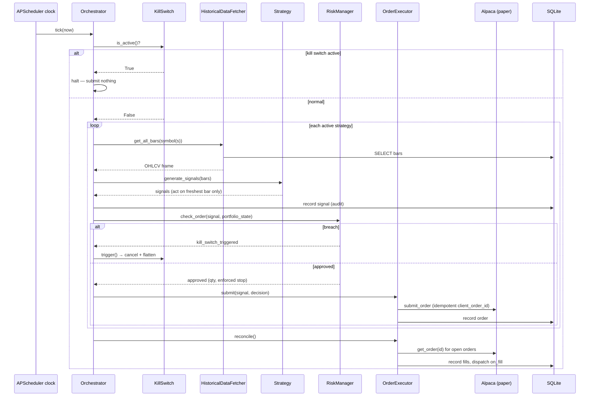

# algotrader — Architecture

A technical walkthrough of how algotrader is layered, how a single tick flows end to
end, the tradeoffs behind the stack, the security model, and what a Phase 2 would
add. For the high-level pitch and setup, see the [README](../README.md).

---

## Layered architecture

Algotrader is deliberately layered so that each concern is independently testable and
the **trading decision path stays pure Python**. Dependencies point downward; no
lower layer imports an upper one.

```
┌──────────────────────────────────────────────────────────────────────┐
│  Orchestration            src/orchestrator/                            │
│    runner.py    APScheduler jobs, NYSE calendar, the pre_open/tick/    │
│                 pre_close loop, simulate_day(), halt handling          │
│    lockfile.py  PID heartbeat for dashboard /healthz                   │
├──────────────────────────────────────────────────────────────────────┤
│  Validation               src/validation/null_wall.py                 │
│    NullWall.enforce() — startup gate; load/verify signed records       │
├──────────────────────────────────────────────────────────────────────┤
│  Execution                src/execution/executor.py                   │
│    OrderExecutor — submit (idempotent IDs), reconcile, reject dispatch │
├──────────────────────────────────────────────────────────────────────┤
│  Risk                     src/risk/                                    │
│    manager.py       the single gate every order passes through         │
│    kill_switch.py   auto-halt on breach, manual-only reset             │
├──────────────────────────────────────────────────────────────────────┤
│  Strategy / Regime        src/strategies/  src/regime/                 │
│    base.py          Null-compatible Strategy interface + Signal        │
│    indicators.py    pure causal SMA / ATR / ADX / true range           │
│    ma_crossover · rsi_mean_reversion · pairs_trading                   │
│    factory.py       build strategies from config + params_hash         │
│    detector.py      realized vol + ADX → 2x2 regime, strategy gating   │
├──────────────────────────────────────────────────────────────────────┤
│  Data                     src/data/pipeline.py                         │
│    HistoricalDataFetcher — fetch→upsert, get_bars_as_of look-ahead     │
│    guard, gap detection                                                │
├──────────────────────────────────────────────────────────────────────┤
│  Storage                  src/storage/db.py                            │
│    SQLAlchemy models: bars, signals, orders, fills, daily_pnl,         │
│    strategy_state, regime_state, kill_switch_events                    │
├──────────────────────────────────────────────────────────────────────┤
│  Broker                   src/broker/alpaca_client.py                  │
│    paper-only guard (import-time + ctor), retry/backoff, no secrets    │
│    in logs                                                             │
├──────────────────────────────────────────────────────────────────────┤
│  Cross-cutting            src/utils/  (config.py pydantic, logger.py)  │
│  Monitoring (read-only)   src/dashboard/app.py  (Flask)                │
└──────────────────────────────────────────────────────────────────────┘
```

The **dashboard** sits off to the side: it reads from Storage and the (cached)
broker account, and writes nothing (enforced by a `before_flush` guard).

---

## Data flow of a single tick



Two properties make this honest:

- **No look-ahead.** A strategy acts only on the *latest* bar's signal
  (`as_of == bars.index[-1]`), and the data layer's `get_bars_as_of` can never
  return a bar past its cutoff.
- **Idempotency.** `client_order_id` is derived from the signal's bar timestamp,
  so a repeated tick on the same bar (or a retry) cannot double-send.

---

## Design tradeoffs

**SQLite over Postgres.** Algotrader is single-node and does not need concurrent
writers or a network hop. SQLite is zero-config, file-backed, trivially testable
with a temp file per test, and more than fast enough for daily-bar workloads. The
SQLAlchemy models would port to Postgres unchanged if a future version needed
multi-process writers.

**structlog over the stdlib `logging`.** Every event is emitted as a structured
record — JSON lines to a date-stamped file (a machine-parseable audit trail) and a
colored renderer to the console. "Every decision is logged with a rationale" is
much cheaper to honor, and later analyze, with structured key/value events than
with free-text log lines.

**APScheduler over Celery.** The scheduling need is a handful of cron jobs in one
process. Celery would drag in a message broker (Redis/RabbitMQ) and a worker pool
for no benefit. APScheduler runs in-process, integrates with the NYSE calendar
check inside each job, and keeps the whole bot a single deployable unit.

**Flask over FastAPI.** The dashboard is strictly read-only and serves one user.
There is no async I/O to exploit, no request fan-out, and no schema-heavy API
surface. Flask's synchronous simplicity is the right size; FastAPI's async stack
would add complexity (and an ASGI server) without a payoff here.

**pandas_market_calendars over a hand-rolled holiday list.** Trading-day logic
(holidays, early closes) is easy to get subtly wrong and changes year to year. A
maintained calendar library is the responsible choice for anything touching when
orders may be placed.

---

## Security model

- **Secrets live only in `.env`**, which is git-ignored. `.env.example` documents
  the shape with placeholders. No key ever reaches a log line — the broker client
  logs request/response *metadata* only.
- **Paper-only is enforced twice.** `assert_paper_trading` runs at import time (if
  `ALPACA_BASE_URL` is set) and again in `AlpacaClient.__init__`. A non-paper host
  raises `LiveTradingError` before a client can exist, so there is no reachable
  code path to a live/funded endpoint.
- **No network calls outside Alpaca.** The runtime talks to exactly one external
  service (Alpaca paper). `pandas_market_calendars` is offline calendar data; the
  dashboard's only outbound call is the cached Alpaca account fetch, wrapped so a
  failure degrades to "account unavailable" rather than crashing.
- **The dashboard cannot mutate state.** Its SQLAlchemy session raises on any
  attempted flush, so a read-only guarantee is structural, not a convention.

---

## Known future work (Phase 2)

Phase 2 is where an LLM would earn a place *outside* the decision path — never
inside the trade math:

- **True LLM orchestration for news-driven position sizing** — an agent that reads
  headlines/filings and proposes a *risk-budget scalar* (still clamped by the
  `RiskManager`), so the model advises sizing but never computes the trade.
- **Cointegration-aware pair rotation** — periodically re-screen a universe of
  pairs for cointegration and rotate the active pair, instead of a single fixed
  XLE/XOP pair.
- **Online validation against Null via API** — replace the file-based validation
  records with a live call to Null's API, so staleness and drift are checked
  against the source of truth rather than a committed JSON snapshot.
- **Adaptive regime detection** — upgrade the 2×2 volatility/trend heuristic to a
  Hidden Markov / Markov-switching model that infers regime transitions
  probabilistically rather than by fixed thresholds.
